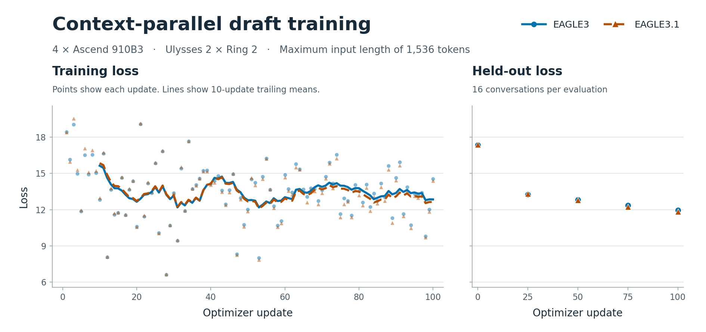

# EAGLE drafts on four Ascend 910B3 devices

This bundle contains short-run training evidence for offline context parallelism in SpecForge. Both drafts start from newly initialized trainable parameters with seed 42. They use the same frozen target and vocabulary map, the same training order, and the same four physical devices. The target is `Qwen/Qwen3-30B-A3B-Instruct-2507@0d7cf239`. Its frozen embeddings are reused by the drafts.

## Loss measurement

The target produced BF16 prefill features from layers 1, 23 and 44. The source pool contains 512 distinct ShareGPT conversations with the original assistant responses and masks. Each arm used 400 distinct examples from that pool. The 16 fixed validation conversations have greedy Qwen responses to independently reserved prompts. Validation prompts were checked against all 8,192 prompts used to construct the shared 32,000-entry vocabulary map. [Capture audit](feature_audit.json) · [Comparison plan](tools/measurement_plan.json)

Training uses Ulysses size 2, Ring size 2, maximum length 1,536, rollout depth 3 with geometric depth factor 0.8, microbatch 1, and four microbatches per completed Adam update. Each optimizer step uses four logical conversations, counted once across all four ranks. Learning rate is 0.0001 with clipping at 0.5. The figure shows every optimizer-window training loss, its trailing ten-update arithmetic mean and each observed validation loss. Compare the first ten and last ten updates within each method. The training and evaluation samples contain varying numbers of masked positions.

The training trace wraps the normal SpecForge CLI at implementation commit `c0725d4400774132f53328ef31e11724defddb05`. It records the real optimizer step, reads the model state and aggregates the same held-out forward loss numerator/denominator over the 16 examples and all ranks on CPU. This companion validation aggregation was used because a direct HCCL SUM of FP64 tensors is unsupported by the tested driver. [Capture script](capture_dataset.py) · [Instrumentation](tools/train_with_trace.py)



| Draft | Mean training loss, 1–10 | Mean training loss, 91–100 | Validation at 0 | Validation at 100 |
| --- | ---: | ---: | ---: | ---: |
| EAGLE3 | 15.639 | 12.844 | 17.347 | 11.952 |
| EAGLE3.1 | 15.850 | 12.630 | 17.395 | 11.825 |

All five held-out measurements decreased for both methods. The evidence covers one seed and 16 held-out examples. The two runs started with bit-identical common parameters, consumed the same 400 examples in the same order, and produced full step-100 checkpoints with finite Adam moments. [Matched-run audit](matched_run_audit.json) · [EAGLE3 CSV](eagle3/steps.csv) · [EAGLE3.1 CSV](eagle31/steps.csv)

## Reproduce

Prepare the pinned target model, fixed vocab and the source ShareGPT and held-out files with the [formal training data preparation](https://github.com/LUOseu/SpecForge/tree/56771b3e2241a9a3be7e0d9f688798d9f5240497/validation/ascend-eagle31-formal). Use the Ascend environment from the same bundle. Captures use the SpecForge SGLang plugin on loopback port 30186, Mooncake TCP metadata on 35880 and its master on 35551. The capture script checks the recorded source and vocabulary digests. Greedy regeneration on another runtime may yield different tokens. Keep an independently regenerated validation set identified by its own checksums.

From a checkout of this evidence branch, set `BUNDLE` to the directory containing this file. Set `SPECFORGE_REPO` to the matching training source. Set `TARGET_MODEL` to the local target snapshot and `VOCAB_MAP` to the original 8k corpus vocabulary file. Use a fresh `RUN` and select allocated chip logic IDs for the four training devices.

```bash
mkdir -p "$RUN/heldout" "$RUN/tools"
cp "$BUNDLE/tools/"{source_manifest.json,train_with_trace.py} "$RUN/tools/"
python "$BUNDLE/capture_dataset.py" "$RUN" "$ORIGINAL_8K" "$TARGET_MODEL" --count 512
python "$BUNDLE/capture_dataset.py" "$RUN/heldout" "$ORIGINAL_8K" "$TARGET_MODEL" --count 16 --heldout
export SPECFORGE_REPO TARGET_MODEL VOCAB_MAP ASCEND_RT_VISIBLE_DEVICES
python "$BUNDLE/tools/run_pair.py" --root "$RUN" eagle3 eagle31
python "$BUNDLE/tools/audit_training.py" "$RUN" eagle3 eagle31
python "$BUNDLE/render_loss.py" --data-dir "$RUN" --output "$RUN/training-loss.png" --updates 100 --setup "4 × Ascend 910B3  ·  Ulysses 2 × Ring 2  ·  Maximum input length of 1,536 tokens"
```

## Correctness and performance checks

The [21-cell capacity and throughput sweep](benchmark.csv) used a Qwen EAGLE3.1 checkpoint and full-length offline features. The separate [gradient tests](parity/ascend_training_parity.json) compare five SP2/SP4 topologies to dense reference training. The [FSDP replay](parity/fsdp_checkpoint_replay.json) compares a resumed and uninterrupted optimizer update. The [Ring profile](parity/ring-overlap-summary.json) measures intersection of on-device HCCS payload transfers with fused attention kernels.
